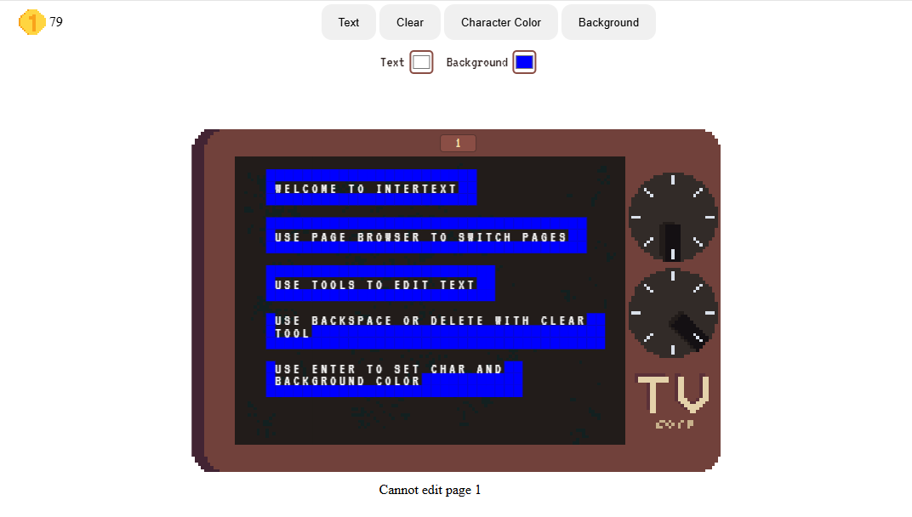
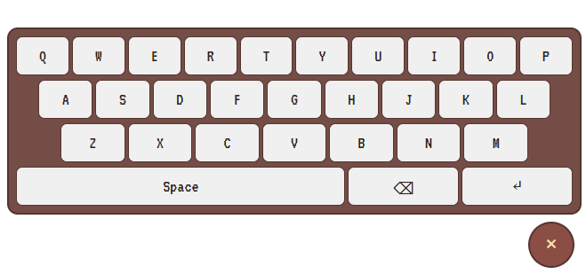

<h1>Intertext: what if wplace was teletext?</h1>

Try it here: <a href="https://intertext.santtu.uk/">https://intertext.santtu.uk/</a>

<h2>Test it locally by running these commands in both the front and back folder</h2>
<ul>
<li>npm install</li>
<li>npm run dev</li>
</ul>

<h2>How it works:</h2>

The site is a canvas with a 40 wide 24 tall grid of cells meant to imitate the look of teletext

Each page is editable with the text, clear, character color and background color tools. Everything is updated live using socket.io. There are 99999 pages you can enter.

The backend handles all the updating and initial page getting and stores the cell details in a sqlite database

On mobile there is also a hardcoded keyboard on page because the system keyboard tends to mess up layout

<h2>Trying it:</h2>

You'll get 1 coin every second when the page is open seen in the top left of the page. Each tool use consumes 1 coin with the exception of the text tool (if it's also changing the background color it will require 2 coins)

You can use the page number field (seen in the top beam above the screen) to switch pages

Select a tool by pressing it and then press anywhere on the canvas and you'll see the slot highlighted

Then if you're using the text tool write characters you want with the colors you want selected at the top

If you're using some of the other tools instead the key you'll need to press is either enter or backspace, the default page 1 will always remind you which is which

ps. I had a pretty high fever while making this so it may be reflected in some strange choices /hj
